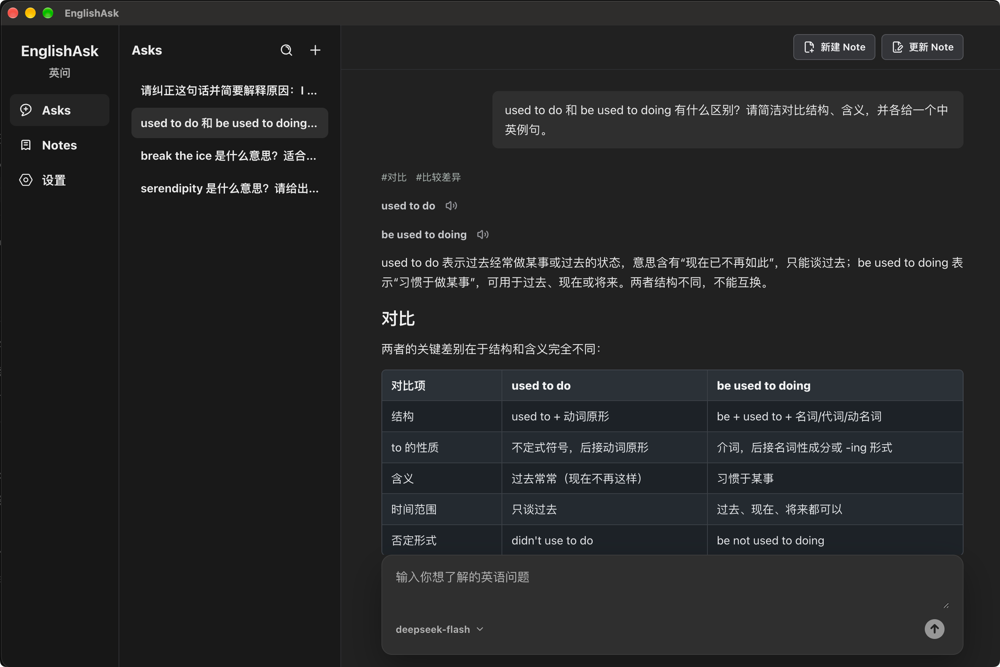
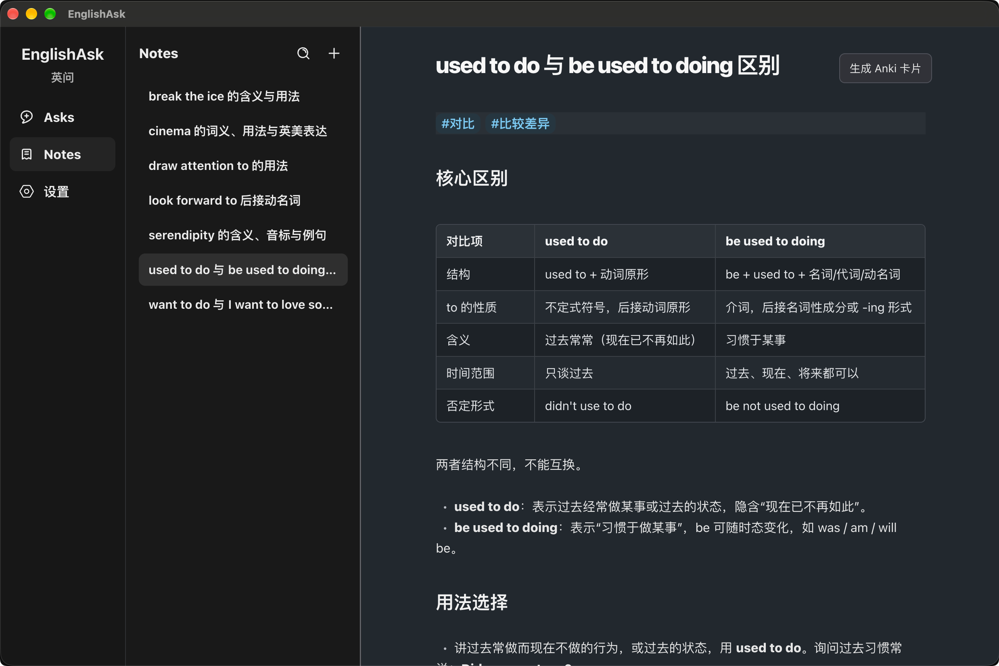
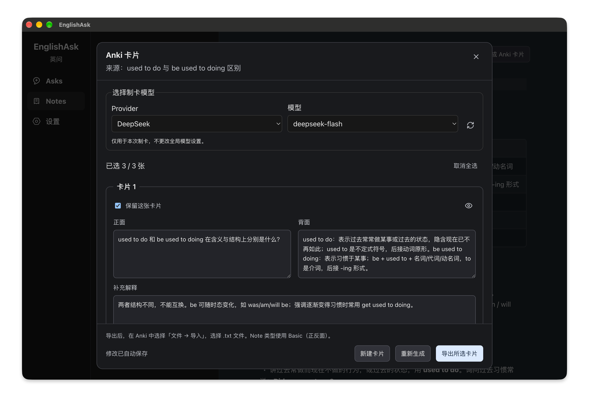
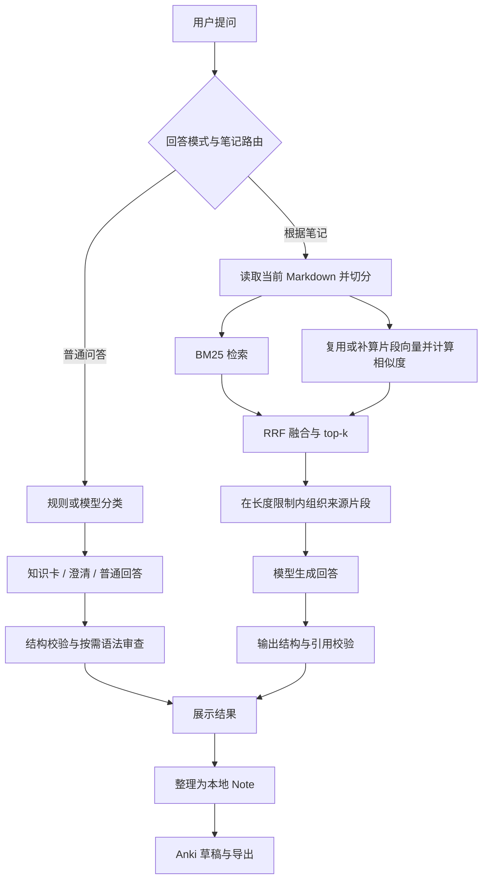

# EnglishAsk · 英问

**将英语问答沉淀为自己的知识库，再用笔记回答问题、制作复习卡片。**

EnglishAsk 是一个 AI 英语学习桌面应用。遇到不懂的单词、句型或语法时，可以直接提问，把有用的回答整理为 Markdown 笔记，再根据自己的笔记复习和制作 Anki 卡片。

笔记保存在本地，可选择已有目录并配合 Obsidian 等编辑器使用。你可以自行选择云端模型，也可以连接 Ollama 中的本地模型。

**提问 → 整理笔记 → 根据笔记复习 → 导出 Anki**

[界面预览](#界面预览) · [下载与安装](#下载与安装) · [首次配置](#首次配置) · [日常使用](#日常使用) · [数据与备份](#数据与备份) · [常见问题](#常见问题) · [开发与技术说明](#开发与技术说明)

## 可以做什么

| 能力 | 使用方式 |
| --- | --- |
| 英语问答与知识卡 | 根据单词、短语、句型、语法概念或比较问题选择回答形式，生成包含相应学习模块的知识卡；支持发音播放。 |
| 本地 Markdown Notes | 从回答整理笔记，编辑、重命名和管理本地文件；支持自定义存储目录、外部修改同步、更新预览与撤销。 |
| 根据笔记回答 | 自动判断是否需要检索笔记；回答附来源编号和原文摘录，可打开对应笔记核对。 |
| 查找笔记 | 按词语或意思查找相关内容，支持用中文提问、查找英文笔记。 |
| Anki 卡片 | 从笔记生成或手动添加卡片，编辑后导出到 Anki 复习。 |
| 自选 AI 模型 | 支持 Google Gemini、OpenAI、DeepSeek、OpenRouter、Anthropic 和 Ollama。 |

不同版本的功能可能有所不同，使用前可查看对应的 [版本说明](release-notes.md)。

## 界面预览

### 提问与理解

直接提出英语问题，查看解释、例句和对比表格。



### 整理为笔记

将有用的回答整理为 Markdown 笔记，在 Notes 中继续编辑和复习。



### 制作 Anki 卡片

根据笔记生成复习卡片，编辑内容、选择需要保留的卡片，再导出到 Anki。



## 下载与安装

前往 [GitHub Releases](https://github.com/Bern3rsH/EnglishAsk/releases)，查看版本说明并下载对应系统的安装文件。下载对应安装包即可使用。

| 系统 | 选择文件 |
| --- | --- |
| macOS Apple Silicon（M 系列芯片） | 文件名包含 `mac-arm64` 的 DMG 或 ZIP |
| macOS Intel | 文件名包含 `mac-x64` 的 DMG 或 ZIP |
| Windows x64 | `win-x64-setup.exe` 安装版、ZIP 或 `win-x64-portable.exe` 便携版 |

以所选版本实际提供的附件为准。macOS 的 DMG 用于安装应用，ZIP 可先解压；Windows 安装版支持选择安装目录，便携版可直接运行。

当前 macOS 安装包未经 Apple 公证，Windows 安装包未配置代码签名。`v0.1.2` 仍记录了安装到 Applications 后可能卡住的问题，安装前请阅读 [版本说明](release-notes.md)。可在 **设置 → 关于与更新** 检查最新正式版、查看更新说明，并点击 **前往下载** 打开下载页；下载后手动安装。

## 首次配置

### 1. 选择回答模型

打开设置中的模型页面，选择模型服务商（Provider），填写对应的 API Key，选择模型并保存。模型列表可通过刷新按钮重新获取；云端模型的调用费用由对应服务商计费。

| 方式 | 需要准备什么 |
| --- | --- |
| Google Gemini / OpenAI / DeepSeek / OpenRouter / Anthropic | 对应服务商的可用 API Key 与模型权限 |
| Ollama | 已启动的 Ollama 服务，以及已经准备好的本地模型；默认地址为 `http://127.0.0.1:11434`，可在设置中修改 |

Ollama 不需要 API Key；EnglishAsk 不会替你下载或启动它的回答模型。切换服务商后，请使用该服务商提供的密钥和模型。

### 2. 选择笔记目录

打开 **设置 → Notes → 选择目录**，选择用于存放 Markdown 笔记的文件夹。不设置时，应用使用自己的默认 Notes 目录，完整路径可在该页面查看。

已有 Markdown 文件可以直接放入所选目录。应用只读取所选文件夹内的笔记，不包含更深层文件夹中的笔记；也可以选择 Obsidian 仓库中的某个具体文件夹。

**切换目录只改变之后读取和保存的位置，不会自动搬迁原有文件。** 如需迁移，请先保存正在编辑的内容，再自行复制笔记和相关附件。

### 3. 按需启用本地语义检索

在 **设置 → Notes → 本地语义检索** 中下载模型，下载量约 **639 MB**。下载完成后，可通过“启用语义 + 关键词检索”开关控制。

启用后，可以尝试用不同说法或中文问题查找英文笔记。不下载也能按关键词查找；无需额外填写密钥，回答仍使用上一步选定的模型。

设置中的其他可选项可以先保留默认配置。

## 日常使用

### 在 Asks 中提问

可以输入单词，也可以写完整的学习问题，例如：

- `resilient 是什么意思？`
- `ask sb to do 是什么句型？`
- `used to 和 be used to 有什么区别？`
- `帮我把这句话改得更礼貌：Send me the file now.`

应用会根据问题选择知识卡、澄清或普通回答。生成过程中可以停止，失败后可使用重试入口。

提问框中按 **Enter** 发送，**Shift + Enter** 换行；中文输入法选词时不会直接发送。

### 把回答整理成 Note

将需要保留的回答整理为笔记，再到 **Notes** 中编辑内容。笔记使用 `.md` 文件保存，列表名称与文件名对应，可以在应用内重命名，也可以用外部 Markdown 编辑器修改。

如需给新笔记标题添加时间，可在 **设置 → Notes** 中启用“标题添加时间戳”。应用会检查外部文件变化；遇到未保存修改或内容冲突时，请按提示处理后再继续保存。

### 根据自己的笔记复习

Asks 会自动判断当前问题是否需要检索已有笔记。

先保存相关笔记，再提问，例如“根据我的笔记，used to 后面接什么形式的动词？”。回答中的来源可以展开查看摘录，或打开原笔记。

如果没有找到相关内容，应用会提示缺少资料。笔记在回答生成后被修改或删除，旧来源可能无法继续打开，此时重新提问以获取最新依据。

### 制作并导出 Anki 卡片

1. 打开一篇已保存的 Note，点击 **生成 Anki 卡片**。
2. 选择生成模型，生成草稿；也可以手动添加卡片。
3. 编辑正面、背面、补充解释和标签，勾选需要导出的卡片。草稿修改会自动保存，失败时可重试。
4. 点击 **导出所选卡片**，保存 `.txt` 文件。
5. 在 Anki 中通过 **文件 → 导入** 选择该文件，使用 **Basic（正反面）** 笔记类型。导入前可预览正面、背面和标签是否对应正确。

导出文件用于手动导入 Anki，应用不会自动同步到 Anki 账户。来源 Note 更新后，卡片可能被标记为过期，需要重新核对或生成。

## 数据与备份

笔记保存在 **设置 → Notes** 中显示的文件夹里。备份或换电脑时，建议复制整个文件夹，包括其中的图片、卡片草稿和隐藏文件。

仅复制 Markdown 文件会保留笔记正文，但不会带上全部附件和卡片草稿。笔记开头由应用添加的信息用于关联来源和卡片，编辑时请保留。

对话历史和应用设置单独保存在本机，复制 Notes 文件夹不会同时迁移这些内容。
本地存储不代表所有操作都离线：使用云端回答模型时，问题及需要的上下文会发送给所选服务商；根据笔记回答时会发送选中的片段，制卡时会使用来源 Note 的内容。

## 常见问题

**为什么模型列表为空或无法提问？**

检查是否选中了正确的服务商、填写并保存了对应 API Key，以及账户是否可以使用所选模型，再刷新模型列表。使用 Ollama 时，检查服务地址、服务是否启动以及本地是否已有模型。

**下载本地语义模型后，就可以完全离线问答了吗？**

下载的模型只帮助查找笔记。生成回答是否需要联网，取决于你选的是云端模型还是本地模型；发音播放等其他功能也可能需要网络。

**为什么明明有笔记，却回答“依据不足”？**

先检查当前 Notes 目录、文件是否已保存、文件是否直接放在所选文件夹内，再尝试包含目标词语的完整问题。检索结果也可能遗漏必要段落，“依据不足”不代表整个笔记库一定没有相关内容。

**可以直接使用 Obsidian 的笔记吗？**

可以选择包含 Markdown 文件的目录。应用只读取所选文件夹内的笔记，部分 Obsidian 插件内容可能无法正常显示；同步编辑时注意应用中的未保存内容与冲突提示。

**切换 Notes 目录后，原来的笔记去哪了？**

文件仍留在原目录。切回原目录即可重新查看；“使用默认目录”同样只切换路径，不会删除自定义目录中的文件。

**为什么打开旧来源或导出卡片时提示内容变化？**

笔记内容可能已在回答或卡片生成后被修改。重新提问，或重新打开卡片检查最新 Note 后再操作。

**必须配置 Jev 吗？**

不需要。保留默认配置即可开始提问。

## 反馈问题

欢迎在 [GitHub Issues](https://github.com/Bern3rsH/EnglishAsk/issues) 反馈使用问题或功能建议。报告问题时，请附上系统与芯片架构、应用版本、使用的 Provider／模型、复现步骤，以及预期结果和实际结果。

涉及笔记检索时，可用不含私人内容的最小 Markdown 示例帮助复现。请勿附带 API Key、完整应用设置文件或私人笔记库。

## 开发与技术说明

本章节面向从源码运行、开发或了解实现的读者。

### 源码运行

项目使用 Electron、React 和 TypeScript。开发环境需要 **Node.js 22.12+（22.x）与 npm**；使用锁文件安装依赖：

```sh
npm ci
npm run dev
```

Electron 和本地推理运行库的安装需要下载平台依赖。启动后按上面的首次配置说明选择模型即可。可选环境变量见 [.env.example](.env.example)，通常可以直接在应用设置中配置 Provider，无需创建 `.env`。

### 一条问答如何完成



语义检索关闭或失败时使用 BM25；没有候选片段时直接提示，不调用回答模型。检索候选仍可能无法支持问题，生成阶段需要说明依据不足。

### 实现说明

#### 1. 分类、生成与质量校验

- 简单单词可走本地规则；其他请求经过模型路由，选择知识卡、澄清或普通回答。
- Jev 可在 **设置 → Jev（可选）** 中启用并配置专用凭据。分类先检查置信度与标签一致性。接纳后合并补全与答案生成，减少串行请求；不合法或失败时回退原流程，取消后不继续启动回退。
- 知识卡执行运行时字段、模块和例句校验；需要语法审查的内容在审查后再次校验。
- 审查失败保留草稿，通过请求上下文与生成输入指纹控制重试复用，避免在模型或上下文已变化时复用旧结果。

代码：[AI 编排](src/main/ai-service.ts) · [混合路由](src/main/hybrid-router.ts) · [合并生成](src/main/merged-jev-answer.ts) · [知识卡校验](src/main/knowledge-card-service.ts)

#### 2. 本地混合检索与向量复用

- Markdown 按结构切分并保留来源身份、内容版本和片段位置；BM25 与向量结果通过 RRF 融合名次。
- 本地 Embedding 使用 Qwen3 Embedding 0.6B Q8_0，由 `node-llama-cpp` 加载，支持应用内下载与文件校验，不依赖 Ollama 服务。
- **当前在每次笔记检索时重新读取、切分文件；切分结果没有缓存。** 语义检索按模型配置和实际 token 输入复用向量，缓存未命中才计算。
- 完整处理成功后提交来源索引并清理无引用向量，防止失败或取消时以半份索引替换旧状态。向量快照保存到磁盘，重启后的首次语义检索按需校验恢复。
- 点击旧引用时重新检查目录、笔记身份、内容版本和片段，避免把过期来源误指向新内容。

代码：[切分与检索](src/main/rag-note-retrieval.ts) · [RRF](src/main/hybrid-retrieval.ts) · [本地推理](src/main/local-embedding.ts) · [缓存](src/main/embedding-vector-cache.ts) · [磁盘恢复](src/main/embedding-vector-store.ts) · [来源导航](src/main/rag-source-navigation.ts)

#### 3. 异步请求与本地数据一致性

- 使用请求身份和状态转换隔离迟到响应，传递取消信号，保留失败请求的重试入口。
- Markdown 保存采用临时文件替换，并在更新／撤销流程中检查预期内容与目录，降低覆盖外部编辑的风险。
- Note 使用持久化身份和来源记录；Anki 草稿保存来源版本与草稿修订号，保存和导出前检查冲突或过期状态。

代码：[请求状态](src/renderer/src/ask-request-state.ts) · [笔记存储](src/main/note-storage.ts) · [外部同步](src/renderer/src/notes-sync.ts) · [Anki 草稿](src/main/anki-drafts.ts) · [导出](src/main/anki-export.ts)

### 测试与构建

测试按运行器分别执行，真实模型测试默认跳过，需要按各测试文件的显式开关和配置单独运行。

```sh
# 应用源码：Vitest
npx vitest run src

# 检索模块回归检查：Node test runner
node --test scripts/rag-bm25-demo.test.mjs scripts/rag-note-demo.test.mjs scripts/rag-query-demo.test.mjs scripts/rag-note-bm25.test.mjs scripts/rag-directory-demo.test.mjs scripts/rag-phrase-bm25.test.mjs scripts/rag-evaluation.test.mjs scripts/rag-bm25-evaluation.test.mjs

# 发布工具检查：需要 npm 提供的运行环境
npm run test:release

# 生产构建
npm run build
```

当前 `npm test` 未区分 Vitest 与 Node 测试文件，建议使用上面的分组命令。根 `tsconfig.json` 仅包含项目引用，`npm run typecheck` 与构建中的根检查不能替代以下源码类型检查：

```sh
npx tsc --noEmit -p tsconfig.node.json
npx tsc --noEmit -p tsconfig.web.json
```

项目仍有独立源码类型检查诊断，尚未达到全量类型检查通过。

### 技术栈与目录

| 层次 | 技术与职责 |
| --- | --- |
| 桌面与构建 | Electron、electron-vite、electron-builder、GitHub Actions |
| 界面与编辑 | React、TypeScript、CodeMirror 6、Markdown |
| 模型调用 | Vercel AI SDK、Provider 适配层、运行时校验 |
| 本地检索 | BM25、RRF、node-llama-cpp、Qwen3 Embedding |
| 数据与测试 | 本地 Markdown／JSON、Vitest、Node test runner |

```text
src/main/           主进程：模型调用、检索、文件存储与 IPC
src/preload/        通过 contextBridge 暴露受限应用接口
src/renderer/src/   React 界面、编辑器与请求状态
src/shared/         跨进程契约、类型与校验规则
scripts/            检索模块、回归检查与打包发布工具
tests/fixtures/     自动化测试所需的合成资料
docs/               发布说明
```

### 数据存储、隐私与当前边界

| 数据 | 保存位置与用途 |
| --- | --- |
| Markdown 笔记 | 设置中显示的 Notes 目录 |
| 笔记图片 | Notes 目录内的 `note-assets/` |
| Anki 草稿 | Notes 目录内的 `.englishask-anki/` |
| 笔记更新的撤销记录 | Notes 目录内的 `.englishask-versions/`；不是完整版本历史 |
| 应用设置与模型缓存 | Electron 应用数据目录；与自定义 Notes 目录分开 |
| 对话历史 | 桌面应用的本地浏览器存储；不包含在 Markdown 笔记备份中 |

备份或迁移笔记时，建议复制整个 Notes 文件夹，包括附件和隐藏目录。仅复制 `.md` 文件可以保留正文，但不会同时保留 Anki 草稿、图片及撤销记录。笔记中由应用维护的 `english_ask` 元数据用于关联来源和卡片，编辑时请保留。

- 本地优先指笔记存储与检索可在本机完成。选择云端回答 Provider 时，问题、相关对话或选中的笔记片段会发送给该 Provider；本地 Embedding 不等于整个问答离线。
- Provider 凭据在应用设置中配置；可选环境配置参见 [.env.example](.env.example)。不要提交本地 `.env` 或个人笔记。
- PostHog 为可选产品遥测，未配置项目 token 时不发送；发布脚本关闭遥测。开发时也可设置 `VITE_TELEMETRY_DISABLED=1`。
- 引用校验验证来源编号与摘录匹配，不能自动证明每个结论都被原文支持。当前采用字符长度限制，尚未接入 Reranker 或回答模型的动态 token 预算。
- 当前面向有界本地笔记库，未采用向量数据库或 ANN 索引，也未完成大规模语料性能评估。

### 打包

在对应操作系统执行：

```sh
npm run dist:mac
npm run dist:win
```

配置目标为 macOS ARM64／x64 和 Windows x64，详细产物与发布步骤见 [打包与发布](docs/releases/README.md)。当前 macOS 使用 ad-hoc 签名、未经 Apple 公证；`v0.1.2` 的发布记录仍列有安装到 Applications 后可能卡住的问题。源码测试与构建成功不代表该安装问题已修复，使用安装包前请查看对应版本说明。
